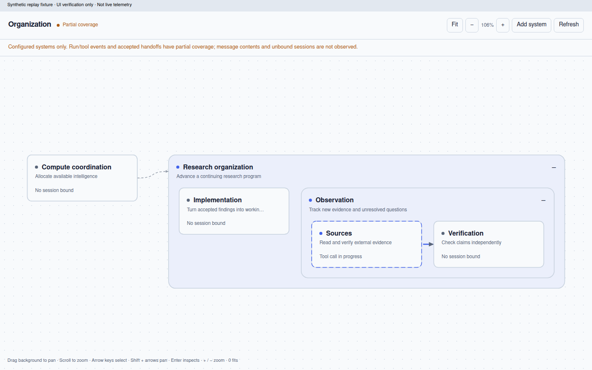

# Viable System Claw

A native OpenClaw plugin for recursive organization and adaptive compute allocation. Responsibilities should outlive the sessions and workflows that carry them out.

The primary interface is a graph of nested systems. A separate compute page shows resource pools, quota windows, model evidence and allocation observations. Both live inside OpenClaw's Control UI.



*Browser verification replay, not live telemetry. Production starts empty.*

## First increment

- **Organization graph:** create purposes, nest systems, add relations and explicitly bind existing native sessions. Pan, zoom, collapse, keyboard navigation and contextual inspection; open conversations through native session surfaces.
- **Observed activity:** run/tool motion and accepted-handoff pulses from correlated metadata. Service restarts and session rebinding invalidate active identities. Disconnected, stale and missing observations are not presented as live work.
- **Durable state:** retained native storage with compare-and-apply updates, tree validation, deduplication, agent-access checks and pre-commit transport budgets.
- **Compute view:** observed shared capacity, overlapping quota windows, profiles and allocations. No fabricated counters, default model hierarchy or decorative metric cards.
- **Compute proposals:** data-driven feasibility and ranking using independent task-quality evidence, per-window consumption, latency, capacity and outstanding commitments. Conservative accounting carries unfinished work across resets. All candidates inform the decision; large explanations are paged.

**This is a tested foundation, not a deployed autonomous controller.** Provider discovery/telemetry adapters, durable reservation-to-dispatch ownership, continuous regulation, verified procedure adoption and operational migration remain unimplemented. A proposal is not an execution receipt. No existing service or responsibility is replaced by this repository.

## Develop

Node **24.22.1+**; native SDK pinned to **OpenClaw 2026.10.10-beta.5**.

```sh
npm ci
npm --prefix hosts/openclaw ci
npm run check
npm test
npm run build:ui
npm run validate
```

The second install supplies the pinned host SDK and CLI. `build:ui` compiles backend TypeScript, bundles the native UI and regenerates its content-addressed manifest. Do not edit asset hashes manually.

See the [native package guide](hosts/openclaw/README.md), [architecture decisions](docs/DECISIONS.md), [verification scope](docs/VERIFICATION.md) and [compute semantics](hosts/openclaw/src/compute/README.md).

## Principles

Persistent purposes are not sessions. Native OpenClaw owns host services, authentication, sessions, tools and navigation; VSC owns organizational state and allocation semantics. Model identities, prices, quota weights and capabilities are supplied or learned data, never permanent routing rules. Observations need provenance; unknown is not healthy. Closing a view does not stop the backend service.
